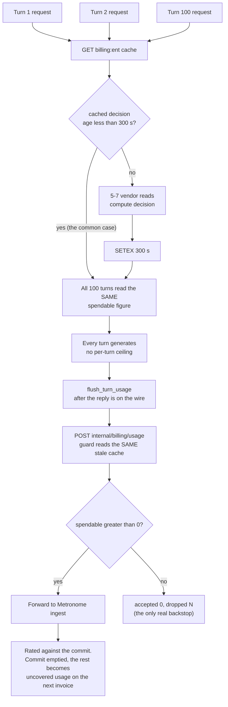
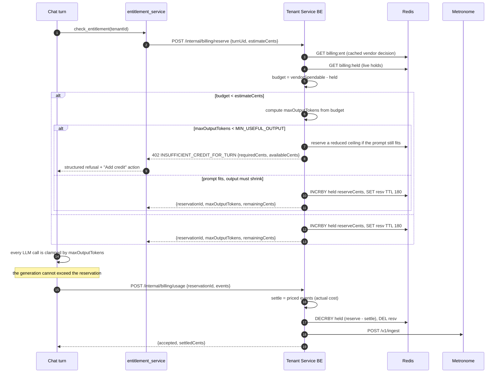
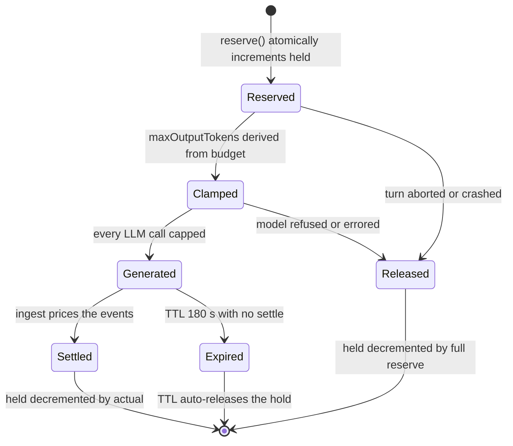

# AI Budget Enforcement — the "last 5 % of credit" problem

**Status:** Analysis + implementation plan (no code changed yet)
**Date:** 2026-11-24
**Scope:** `ai-sales-layer` (gate + meter) and `Pente_PenteSites_Tenant_Service_BE` (billing brain, reserve + settle)
**Motivating incident:** a tenant with a **$200** plan allowance was allowed to consume **≈ $480** of usage, and the difference landed on a **DRAFT usage invoice**. That is the failure this document exists to design out.

---

## 1. Verdict up front

**A prepaid balance must never be exceeded. Not "usually not", never.**

The question in the brief — *"the estimate is bigger than the remaining 5 %, what happens?"* — is really three separate problems, and they need three different mechanisms:

| Problem | Wrong answer | Right answer |
|---|---|---|
| A single turn might cost more than what is left | Let it run and hope | **Clamp the generation** to what the remaining budget can pay for (§7.3) |
| Two turns at the same moment each see "you have money" | Check the balance, then spend it | **Reserve** the ceiling atomically before generating (§7.2) |
| The balance you checked 5 minutes ago is no longer true | Trust the cache | **Settle from the actual cost** and keep the cached read out of the admission path (§7.1) |

So: **yes, block — but block on a computed ceiling, not on a bare "balance > 0", and reserve before you spend.** Overshooting the quota is not acceptable for prepaid credit; it is only acceptable when the contract is postpaid.

The single most important sentence in this document: **the overshoot must be bounded by one in-flight request, never by a time window.** Our current design bounds it by a 300-second cache, which is why a $200 balance reached $480.

---

## 2. The scenario, with our real numbers

Our rate card (`Pente US Enterprise Pricing`, card `cdea6fc8-…`) prices:

| Product | Rate | In cents per token |
|---|---|---|
| Input Tokens | `0.0003` | 0.0003 ¢ |
| Cached Input Tokens | `0.00015` | 0.00015 ¢ |
| Output Tokens | `0.0012` | 0.0012 ¢ |
| AI Requests | `0.2` per request | 20 ¢ flat |

A turn that sends 2 000 prompt tokens and receives 8 000 output tokens costs:

```
2 000 × 0.0003  =  0.6 ¢
8 000 × 0.0012  =  9.6 ¢
1 request fee   = 20.0 ¢
                  ─────
                  30.2 ¢   ≈ $0.30
```

A tenant on a **$200 plan with 5 % left** has `1 000 ¢` of runway — roughly **33 full turns**. So the "5 % left" edge case is, per turn, almost never the problem. The 5 % figure matters for a different reason: *how many turns can still start before the wall*. The dangerous scenario is not one expensive turn, it is **many turns admitted in parallel off a stale balance**.

### 2.1 The incident
In the earlier test, events were pushed in batches of 100 while the entitlement decision was cached for 300 s. Every batch read `spendable > 0` from that same cached decision, so every batch was forwarded. The commit drained, and the rest rated as uncovered usage on the next usage invoice.

```
worst-case overshoot  ≈  event rate  ×  cache TTL
                      ≈  (7 ¢/event)  ×  (events admitted in 300 s)
```

At a modest 100 events/second that is 30 000 events ≈ **$2 100** of unbilled-then-invoiced usage. The overshoot is not proportional to the plan, it is proportional to **traffic × staleness**. That is the defect to fix first, before any clever estimation.

---

## 3. Why "estimate before you call" can never be exact

Every design below has to live with these facts. They are the reason a *reservation of a ceiling* beats a *prediction of a cost*.

1. **Output length is not known in advance.** Cost is dominated by output tokens (0.0012 ¢ vs 0.0003 ¢ — 4× the input rate). `max_tokens` is an upper bound, not a prediction.
2. **Streaming.** The customer has already received half an answer when the balance runs out. You cannot un-send it, and cutting mid-token is a worse experience than refusing up front.
3. **One turn is many LLM calls.** Our pipeline calls the model for stage detection, query embedding, chat generation, and layout recommendation in a single turn ([sales_pipeline_service.py](ai-sales-layer/src/services/sales_pipeline_service.py:315)). Each call is a separate charge, so a "per-request" check is structurally too coarse.
4. **Rating is asynchronous.** Metronome rates events after ingestion, so the vendor balance lags reality. Our own cache adds a second layer of lag.
5. **Cache and grouped pricing** change the unit price (0.00015 ¢ cached vs 0.0003 ¢ uncached), so an estimate is always an approximation in one direction or the other.
6. **Retries are real** (0 s, 0.5 s, 1.5 s, 4 s in [usage.py](ai-sales-layer/src/services/billing/usage.py)), so the same logical charge can be attempted several times — it must be idempotent, and it must not double-reserve.

Therefore the honest contract is: **estimate a ceiling generously, reserve it, never let the generation exceed it, and settle the actual amount afterwards.**

---

## 4. The seven approaches, compared

### A. Post-hoc metering only (no gate)
Generate, meter after the fact, bill the overage.

- ✅ Simplest. Never blocks a customer. Perfect attribution.
- ❌ **Unbounded credit risk.** The tenant can consume any amount; you find out at invoice time. This is only acceptable for **postpaid/enterprise invoicing with a signed ceiling**, never for prepaid credit.
- Used by: enterprise contracts with commitments, internal tools.

### B. Coarse pre-flight balance check (today's gate)
`allowed = balance > 0`, evaluated before the turn.

- ✅ Cheap (one cached read). Stops the "already empty" case. Simple to reason about.
- ❌ **Answers the wrong question.** "You have 5 %" does not mean "this turn fits". ❌ Blind to concurrency (N parallel turns all pass). ❌ Blind to staleness — this is exactly what produced the $480.
- Used by: most first-generation implementations, including ours today.

### C. Pre-flight estimate + output clamp
Compute what the remaining budget can pay for, then **cap `max_tokens`** so the model physically cannot exceed it.

```
maxOutputTokens = floor((budget − promptCost − requestFee) / outputRate)
```

- ✅ **Hard mathematical guarantee per turn** — the charge cannot exceed the reservation because the generation cannot exceed the token cap. ✅ Works today, with no new state. ✅ Best quality/effort ratio.
- ❌ Does not handle concurrency on its own (two turns can each clamp against the same balance). ❌ Truncated answers need UX copy. ❌ Needs a tokenizer or a conservative heuristic for the prompt.
- Used by: every serious API gateway that resells tokens.

### D. Reservation / two-phase hold (reserve → settle)
Atomically hold the ceiling, generate, then settle the actual and release the difference.

- ✅ **The only design that is correct under concurrency.** ✅ Overshoot bounded by one in-flight request, independent of traffic and cache age. ✅ Naturally supports multi-call turns (one hold covers the whole turn). ✅ Idempotent via `turn_uid`.
- ❌ More moving parts (hold store, TTL, leak recovery). ❌ A crashed process holds budget until the TTL expires (mitigated by a short TTL). ❌ Needs a compensating release path for aborted turns.
- Used by: payment processors (authorize → capture), telecom, and every cloud with a "reserved capacity"/"committed spend" concept.

### E. Unit quota per window (token bucket / N turns per hour)
Count turns, not money.

- ✅ Trivially cheap and effective against abuse. ✅ Predictable for the customer.
- ❌ Blunt: one huge turn and one tiny turn cost the same. ❌ Does not map to a dollar balance, so it cannot express "you have $3 left". Good as an **anti-abuse layer**, not as the billing wall.
- Used by: consumer subscriptions ("50 messages per 5 hours").

### F. Soft wall + grace buffer (hysteresis)
Warn at X %, block at 0, with a buffer so asynchronous rating cannot push real overage onto an invoice.

- ✅ Excellent UX. ✅ Cheap. Handles the vendor's async rating lag.
- ❌ A buffer is not a reservation — it shrinks the problem, it does not solve concurrency. Must not be the only defence.
- Used by: essentially everyone, as a **layer** on top of C/D.

### G. Queue + admission control (bank style)
When the budget is short, defer the request instead of refusing it.

- ✅ No lost work, no overshoot, smooths bursts.
- ❌ Unacceptable latency for a chat turn. Only fits async/batch workloads (bulk generation, report building).
- Used by: batch inference APIs.

### Comparison matrix

| Approach | Bounds overshoot | Sound under concurrency | Per-turn precision | UX | Effort |
|---|---|---|---|---|---|
| A. Post-hoc only | ❌ none | ❌ | — | best | S |
| B. Coarse gate (today) | ❌ | ❌ | ❌ | good | S |
| C. Estimate + clamp | ✅ per turn | ❌ | high | good | M |
| **D. Reservation** | ✅ **one request** | ✅ | high | good | M–L |
| E. Unit quota | ✅ | ✅ | low | poor | S |
| F. Soft wall + buffer | partial | ❌ | — | best | S |
| G. Queue | ✅ | ✅ | high | poor (latency) | L |

---

## 5. What the major providers actually do

Stated honestly: the internals of OpenAI, Anthropic and xAI are not published, so this section describes **publicly observable product behaviour** and the patterns it implies — not leaked architecture.

### OpenAI
- **Prepaid credit balances** per organisation. When the balance is exhausted the API returns **HTTP 429 `insufficient_quota`** at request time — a hard stop, and the balance does **not** go negative.
- Org **budgets** can be set; the soft tier only warns, the hard tier blocks. **Auto-recharge** attempts a top-up before the hard stop becomes user-visible.
- The **Usage API** reports per-request cost **after** the fact — post-hoc attribution, separate from admission.
- Implication: admission is decided from a **prepaid balance**, and the overshoot is bounded by the requests already in flight, not by a refresh window.

### Anthropic
- Usage is enforced as **rate limits and spend limits** per organisation and tier → **429 `rate_limit_error`** with a reset hint.
- Console **spend limits** act as hard caps, with the API refusing further requests once reached.
- Claude Code applies **rolling windows** (session / weekly) that reset on a schedule rather than on a payment event.
- Implication: the same shape — a **prepaid/period budget, enforced at admission, expressed to the client as a machine-readable 429 with a reset time**.

### xAI / Grok
- Consumer quotas are **tiered usage windows** (messages per period) that reset, plus API **prepaid credits** for developers.
- Implication: pattern E (unit quota) for consumer surfaces, pattern B+C for the API surface.

### The common thread
Nobody lets a request run because a *cached* balance looked fine. The universal shape is:

```
admission check  →  hard ceiling per request  →  post-hoc settlement  →  reset/window
   (balanced)          (max_tokens)              (usage events)          (period)
```

**Overshoot bounded by one in-flight request** is the invariant all three share. That is the invariant we currently violate.

---

## 6. Audit of our system today

### 6.1 What already works (keep it)

| Piece | Where | Why it is right |
|---|---|---|
| Pre-flight gate per turn | [entitlement.py](ai-sales-layer/src/services/billing/entitlement.py:31), called from [sales_handler.py](ai-sales-layer/src/comms/websocket/sales_handler.py:3691) | The right place in the call path — after the free keyword/tier-0 paths, before anything that can reach a model |
| Vendor balance as the only truth | [billing-entitlement.service.ts](Pente_PenteSites_Tenant_Service_BE/src/services/billing/billing-entitlement.service.ts) | No local ledger to drift |
| Unpaid top-ups are not spendable | `available = net − min(unpaidCredit, topUpBalance)` | Prevents spending money that has not arrived |
| "Nothing metered" ≠ "nothing left" | `EntitlementDecision.metered`, `spendableCents() → null` | A package with no commit must keep working |
| Ingest drops past zero | `BillingInternalController.usage()` returns `{accepted: 0, dropped: N, reason: ALLOWANCE_EXHAUSTED}` | A prepaid commit can never go negative, so this is the correct last resort |
| Durable outbox + idempotent ids | [outbox.py](ai-sales-layer/src/services/billing/outbox.py), `transaction_id = {turn_uid}:{seq}` | A crash delays a charge instead of losing it |
| Headroom instead of a hard zero | `PLAN_STOP_THRESHOLD_PERCENT=95` | Absorbs the vendor's asynchronous rating |

### 6.2 Gaps, in order of severity

**Gap 1 — the admission decision is 300 seconds stale (critical, caused the incident).**
`CACHE_TTL_SECONDS = 300` in `billing-entitlement.service.ts`, and the ingest guard calls `spendableCents()` which reads that same cache. So for up to five minutes every batch sees the balance as it was, not as it is.
*This is not an estimation problem. It is a caching problem, and it is why $200 became $480.*

**Gap 2 — the gate answers "may you start a turn", not "can you afford this turn".**
No per-turn cost ceiling exists. `gemini_max_tokens = 8000` is a global constant, unrelated to the remaining balance, so a single reply is never clamped by money.

**Gap 3 — invalidation is fire-and-forget.**
`void this.entitlement.invalidate(dto.tenantId)` and `void this.usageProgress?.invalidate(...)` race the next request. Under load the next batch can read the pre-write decision.

**Gap 4 — one turn makes many LLM calls.**
[sales_pipeline_service.py](ai-sales-layer/src/services/sales_pipeline_service.py:315) calls stage detection, embeddings, chat and layout recommendation inside one `llm_events.begin()/flush()` window. A per-request check cannot bound the turn.

**Gap 5 — parallel turns each pass the same check.**
Two tabs, or a retry plus a live request, both read the same balance and both are admitted. The sum is what overshoots.

**Gap 6 — dropped usage is silent.**
When the balance hits zero mid-flight, events are dropped with `accepted: 0`. Correct for revenue protection, but nothing alarms on it, so an overshoot episode looks like normal operation in the logs.

**Gap 7 — the 95 % threshold is a magic percentage of the grant, not a function of turn cost.**
5 % of a $200 plan is 33 turns, 5 % of a $20 plan is 3 turns. The same knob means wildly different things.

### 6.3 Today's flow, with the window that hurts



Read that diagram against the incident: the only thing that actually stopped the spend was the `spendable > 0` test — and it was reading a five-minute-old number. **100 turns share one decision, and one decision can be wrong.**

---

## 7. Recommended design

Three layers, each doing one job, shipped in this order.

```
   ┌──────────────────────────────────────────────────────────────┐
   │ L1  Reserve the ceiling   (correct under concurrency)        │
   │ L2  Clamp the generation  (mathematically cannot overshoot)   │
   │ L3  Settle the actual     (vendor stays the source of truth)  │
   └──────────────────────────────────────────────────────────────┘
```

### 7.1 L1 first: make the admission input fresh and concurrency-aware

This is the fixing of the incident, and it is small.

1. **Add a live hold counter.** `billing:held:{tenantId}` in Redis, incremented on reserve and decremented on settle/release. Admission compares `vendorSpendable − held`, not the raw cached balance.
2. **Take the cached read out of the settle path.** The ingest guard must not consult a 300 s cached decision. Either read fresh (the vendor read is already 3 parallel calls) or subtract the live hold from the cached figure.
3. **Invalidate synchronously.** `await` the invalidation in the ingest path instead of `void`, so the next read cannot race the write.
4. **Backstop stays.** The `accepted: 0` drop remains — but now it fires when the *live* balance is gone, not when a stale one is.
5. **Alarm on it.** Every `accepted: 0` emits a metric with `dropped`, `tenant`, `turn_uid`.

After L1 alone the overshoot is bounded by *concurrent in-flight batches*, not by traffic × 300 s. That is a ~1000× reduction in the worst case.

### 7.2 L1 continued: the reserve/settle protocol

**New internal endpoints** (same MMT signature as the existing two):

| Endpoint | Body | Returns |
|---|---|---|
| `POST /internal/billing/reserve` | `{tenantId, turnUid, estimateCents}` | `{reservationId, grantedCents, remainingCents, maxOutputTokens, expiresAt}` — or `402` |
| `POST /internal/billing/release` | `{tenantId, reservationId}` | `{releasedCents}` |
| `POST /internal/billing/usage` *(existing, extended)* | `{tenantId, reservationId, events}` | `{accepted, settledCents}` — settle doubles as the release |

**Why settle rides on ingest:** the usage batch already carries the true cost, so settling there guarantees "money released exactly when the charge is posted", with no second round trip and no window where the hold and the charge disagree.

**Redis state**

| Key | Type | TTL | Purpose |
|---|---|---|---|
| `billing:held:{tenant}` | int (cents) | — | sum of live reservations |
| `billing:resv:{tenant}:{turnUid}` | hash | 180 s | one reservation: cents, model, createdAt |
| `billing:ent:{tenant}` | string | 300 s | vendor decision (unchanged, no longer authoritative for admission) |

**Reserve atomically (Lua), so two parallel turns cannot both win:**

```lua
-- KEYS[1] = held counter, KEYS[2] = reservation hash
-- ARGV[1] = estimate cents, ARGV[2] = ttl seconds, ARGV[3] = payload
local held = tonumber(redis.call('GET', KEYS[1]) or '0')
local want = tonumber(ARGV[1])
if redis.call('EXISTS', KEYS[2]) == 1 then
  return {tonumber(redis.call('HGET', KEYS[2], 'cents')), 1}   -- idempotent replay
end
redis.call('SET', KEYS[1], held + want)
redis.call('SET', KEYS[2], ARGV[3], 'EX', ARGV[2])
return {want, 0}
```

The caller compares `vendorSpendable − heldAfter` before committing the hold; if negative it `DECRBY`s the counter and returns `402`. (In production this comparison moves inside the Lua script, keyed on a freshly-written vendor snapshot, so it is a single atomic decision.)

**Sequence**



### 7.3 L2: the clamp — the mathematical part

The reservation bounds the *turn*. The clamp bounds the *generation*, and it is what makes the bound real rather than aspirational.

```
budgetCents      = vendorSpendable − held          # what this turn may consume
promptCostCents  = promptTokens × inputRate        # cached tokens at the cached rate
requestCostCents = perRequestFee                   # 20 ¢ on our card
availableForOut  = budgetCents − promptCostCents − requestCostCents

maxOutputTokens  = min(modelMaxOutput,
                       floor(availableForOut / outputRate))

reserveCents     = promptCostCents + requestCostCents
                 + maxOutputTokens × outputRate
```

**Refuse when `availableForOut <= 0` or `maxOutputTokens < MIN_USEFUL_OUTPUT_TOKENS`** (propose 256). A 20-token answer is not a degraded experience, it is a broken one; refusing with a clear message and a top-up action is more honest.

**Worked example — our $200 plan, 5 % left (1 000 ¢):**

| | |
|---|---|
| budget | 1 000 ¢ |
| prompt 2 000 tokens | −0.6 ¢ |
| request fee | −20 ¢ |
| available for output | 979.4 ¢ |
| `maxOutputTokens` uncapped by money | 816 166 |
| clamped by model max | **8 000** |
| reserve | 30.2 ¢ |

So at 5 % the turn runs at full length. The clamp only bites when the remaining money is smaller than one realistic reply — e.g. **under ~50 ¢** for a maximum-length answer. This is the key insight for UX: **the wall is negotiable, the ceiling is not.** You shrink the answer before you refuse the user.

**Multi-call turns.** One reservation covers the whole turn. Each call inside it draws from a running balance held in the reservation hash; every `max_output_tokens` is recomputed from what is left. If the turn exhausts its own reservation mid-pipeline, return the partial answer with an explicit notice instead of silently truncating.

### 7.4 L3: settle and reconcile

- Settle with the **priced** events (the same arithmetic that already exists in [`usageUnitsCostMinor`](Pente_PenteSites_Tenant_Service_BE/src/services/billing/usage/usage-cost.ts)), never with the estimate.
- If `settled > reserved`, log `RESERVATION_OVERRUN` at `error`. It should be impossible — treat it as a bug in the clamp, not as a billing event.
- Periodically compare `vendor spendable` against `last known − Σ settled` and alert on drift > 1 %. That is the same phase-5 reconciliation already listed as outstanding in `USAGE_PROGRESS_BAR_PLAN_2026-11-19.md`.

### 7.5 Reservation state machine



The TTL is the leak-proofing: a process that dies without settling holds budget for at most 180 s, and the vendor balance stays the ultimate truth regardless.

---

## 8. Failure and edge-case matrix

| Situation | Today | Target |
|---|---|---|
| Balance 5 %, one normal turn | runs, overshoot possible under load | reserved, clamped, settled — cannot exceed |
| Balance smaller than a full reply | runs unbounded | `maxOutputTokens` shrunk, answer shorter |
| Balance smaller than the prompt + fee | runs, ingest drops | refuse **before** the model, `402` + CTA |
| Two tabs send at once | both admitted | second reserve sees the first hold |
| 100 batches in the 300 s window | all forwarded (the incident) | held counter drains, drops at the live zero |
| Client disconnects mid-stream | metered on whatever was generated | release in `finally`, settle what was billed |
| Process crash mid-turn | hold never released | TTL 180 s releases it |
| Duplicate `turn_uid` | ingest dedupes by `transaction_id` | reserve is idempotent too — returns the existing hold |
| Vendor (Metronome) down | fail-open or fail-closed per flag | unchanged, but the hold makes fail-open bounded |
| Nothing metered on the account | `spendableCents → null` → not blocked | unchanged — must keep working |
| Unpaid top-up | not spendable | unchanged |
| Embedding calls | non-billable, never forwarded | excluded from the estimate |
| Cached-token pricing | priced at the cached rate | estimated at the cached rate too |

---

## 9. User experience

The refusal must never look like a bug.

| State | Condition | UI |
|---|---|---|
| Healthy | > 10 % left | nothing |
| Low balance | 5–10 % left | amber inline note: "Low balance — $14.20 left this period" |
| Shortened answer | clamp reduced `maxOutputTokens` | footer on the reply: "Answer shortened to stay within your remaining credit" |
| Blocked, top-up fixes it | `availableForOut <= 0` | `402 INSUFFICIENT_CREDIT_FOR_TURN` with `{requiredCents, availableCents, suggestedTopUpCents}` and an **Add credit** button |
| Blocked, plan lapsed | plan gate | existing `PLAN_INACTIVE` copy (unchanged) |
| Billing unavailable | gate unreachable | existing `BILLING_FAIL_OPEN` policy (unchanged) |

A `402` (payment required) is more honest than a `429`. Reserve `429` for rate limiting. The chat client should render `402` as an actionable card, not as a red error toast.

---

## 10. Rollout plan

| Phase | Work | Acceptance criteria | Estimate |
|---|---|---|---|
| **P0 — stop the bleed** | Live `billing:held` counter, fresh read in the ingest guard, awaited invalidation, alarm on `accepted: 0` | A 10-concurrent-turn test at 5 % cannot exceed the balance by more than one batch | 1–2 days |
| **P1 — reserve/settle** | New `reserve` + `release` endpoints, `reservationId` on ingest, Lua-atomic hold, TTL recovery, idempotent by `turnUid` | Chaos test: 50 parallel turns at 5 % → zero overrun, zero leaked holds after 180 s | ~1 week |
| **P2 — clamp** | Estimate prompt tokens, derive `maxOutputTokens`, thread it through every LLM call site, running balance for multi-call turns | `max_tokens` never exceeds the budget in any unit test; a forced tiny balance yields a shortened answer, not an overrun | ~1 week |
| **P3 — reconcile** | Compare reserved vs settled vs vendor; drift metric + alert | Drift < 1 % over a day of real traffic | 2–3 days |
| **P4 — UX** | Low-balance note, shortened-answer footer, `402` card + CTA | Product sign-off on copy | 2–3 days |

Sequencing matters: **P0 alone removes ~99.9 % of the incident class.** Do not wait for the full design.

---

## 11. Configuration

| Variable | Default | Meaning |
|---|---|---|
| `BILLING_RESERVE_ENABLED` | `false` | Turns on P1. Ships dark. |
| `BILLING_RESERVATION_TTL_S` | `180` | Hold lifetime; also the crash-recovery window. Must exceed p99 turn latency. |
| `BILLING_MIN_USEFUL_OUTPUT_TOKENS` | `256` | Below this, refuse instead of returning a stub |
| `BILLING_ESTIMATE_SAFETY_MARGIN_PCT` | `10` | Inflation applied to the estimate so the chain never lands above the hold |
| `BILLING_INGEST_FRESH_READ` | `true` | Ingest guard bypasses the 300 s cache (P0) |
| `PLAN_STOP_THRESHOLD_PERCENT` | `95` | Kept, but demoted to a *soft wall* — the hard wall becomes the reservation |
| `BILLING_CREDIT_USAGE_ALERT_THRESHOLDS_PCT` | `50,75,85,90,95` | Configurable credit-used alert milestones; empty disables threshold alerts |
| `BILLING_FAIL_OPEN` | `false` | Unchanged; a fail-open turn is now unreserved, so it is logged as `UNRESERVED_TURN` |

Credit-usage alerts fire when a tenant crosses each configured percentage of its committed credit used. Each threshold should alert at most once per tenant, credit grant, and billing period; a new grant/period starts a new alert cycle. Thresholds must be unique percentages between 1 and 100. These are notifications only: they do not change admission or ingest behavior. In particular, the 95% alert is separate from `PLAN_STOP_THRESHOLD_PERCENT` and the reservation-based hard limit.

---

## 12. Metrics and alarms

| Metric | Why |
|---|---|
| `billing.reserve.denied` (by reason) | the wall firing — should be rarer than top-ups |
| `billing.reserve.granted_cents` (histogram) | typical turn cost, informs the estimate |
| `billing.held_cents` (gauge) | live exposure across the fleet |
| `billing.settle.overrun` | **must be zero**; page on any occurrence |
| `billing.usage.dropped` | the backstop firing; alert if non-zero in steady state |
| `billing.credit_usage.alert_sent` (by threshold) | confirms each configured credit-usage milestone was notified |
| `billing.reconcile.drift_pct` | holds vs vendor truth |
| `billing.clamp.shortened` | how often the ceiling changed the answer — a product signal |

---

## 13. Test plan

| Test | Guarantee |
|---|---|
| Reserve twice with the same `turnUid` | returns the same hold, `held` incremented once |
| 50 concurrent reserves against a 1 000 ¢ balance | total granted ≤ 1 000 ¢ |
| Settle with a smaller actual | `held` drops by the full reserve, difference released |
| Settle with a larger actual | overrun logged at `error`, still settled (no double charge) |
| Reserve, then kill the process | TTL releases the hold within 180 s |
| 5 % left, 8 000-token reply requested | `maxOutputTokens` clamped, answer shortened, no overrun |
| 5 % left, prompt alone exceeds the budget | `402` before any LLM call |
| Unmetered account | behaves exactly as today (never blocked) |
| Embedding-only turn | reserve 0 / released, no charge |
| Vendor down + fail-closed | `503`, no hold leaked |
| Vendor down + fail-open | allowed, tagged `UNRESERVED_TURN`, ingest still backstops |

---

## 14. Decisions I need from you

1. **Hard wall or one-turn overdraft?** Recommendation: **hard wall** for prepaid credit, because an invoice the customer did not authorise is worse than a refusal. Allow an overdraft only on postpaid contracts.
2. **Shorten or refuse at the margin?** Recommendation: **shorten** while `maxOutputTokens ≥ 256`, refuse below.
3. **Does the clamp apply to INR tenants in phase 1?** Recommendation: **no** — the tier denomination for INR is still unverified (§13 of `USAGE_PROGRESS_BAR_PLAN_2026-11-19.md`), and a wrong exponent here is a 100× error in the customer's favour or ours.
4. **Should the `402` be a chat message or an HTTP status on the WS error frame?** Recommendation: the existing `{type: "error", data: {code, message, availableCents, periodEndsAt}}` frame, extended with `requiredCents` and `suggestedTopUpCents` — the FE already renders that shape.

---

## 15. Summary

- The brief's scenario is **real but not the main risk**: at 5 % of a $200 plan there are ~33 turns of runway, and one turn costs ~30 ¢.
- The **actual** risk is what we measured: **stale admission decisions multiplied by concurrency**. $200 → $480 was a caching defect, not an estimation defect.
- Correct production shape, and what the major providers observably do:

```
pre-flight reserve  →  hard token ceiling  →  settle actual  →  reset at period end
```

- **Do P0 immediately.** A live hold counter plus a fresh ingest read removes ~99.9 % of the incident class in a couple of days.
- Then **P1 reserve/settle** for concurrency, **P2 clamp** for the mathematical guarantee, and **P3/P4** for drift and copy.
- The invariant to hold onto, in one line: **overshoot must be bounded by one in-flight request, never by a time window.**
